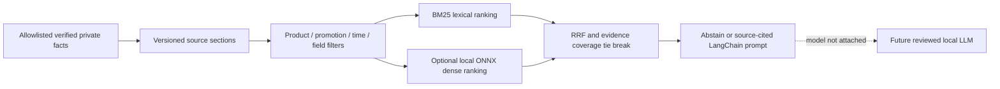

# Local knowledge retrieval and content tuning

Implemented release slice: a real LangChain retrieval/prompt pipeline, local multilingual ONNX embedding comparison, and a gated content LoRA preparation/train/evaluation entry point. No content model has been trained. No LLM is attached to the prompt pipeline. No API key, paid inference, TikTok write or automation change is involved.

## What runs now

Requires Node 22+. Dependencies are pinned in `package-lock.json`: `@langchain/core` 1.3.1 and `@huggingface/transformers` 4.3.2.

```powershell
npm ci
npm run knowledge -- index
npm run knowledge -- query "Ưu đãi Sakura TikTok hiện tại?"
npm run knowledge -- query "Sakura giá bao nhiêu?"
```

`index` reads an allowlist from the canonical private campaign and checked-in promotion policy. It imports product identity/500ml label attribution, the verified current first-50-order TikTok offer, material/evidence policy, and the source-bound [footage editorial policy](FOOTAGE_EDITING.md). The latter records the accepted Southern female Thùy Dung1.2x profile, promotion-first pain hooks and illustrative-stock limits. It does **not** serialize campaign messages, leads, credentials, media, historical captions or posting receipts. The old Mua3tặng1 post and already accepted offers remain unchanged and are excluded from new-promotion retrieval.

The current verified source sections are bounded facts rather than arbitrary document chunks. Keeping each offer section intact preserves its eligibility, order unit, limit and unknown redemption count. Source records carry `sourceId`, `sourceUri`, `sourceHash`, `productId`, `promotionKey`, `verifiedAt`, `validFrom`, `validTo`, `section` and `claimFields`. `timestampBasis` distinguishes actual current-card visual QA from a policy document's modification time; neither establishes cleaning efficacy. Missing/unverified/conflicting records fail validation. The importer requires the exact current promotion structure, text and channel. It pins the reviewed editorial facts section's hash; a changed facts section needs review of the imported text and approved hash. An unrelated execution-section edit does not renew stale hardcoded facts automatically.

Index and models live outside Git, by default at `%USERPROFILE%/.codex/data/tiktok-autoposting/knowledge/`. Corpus hashes and source IDs make indexing deterministic and idempotent; removed sections disappear on rebuild. `index.json` is replaced through a temporary file. One preparation owner should write a knowledge directory at a time. `TIKTOK_KNOWLEDGE_DIR` can override the private directory; do not point it into tracked source folders.



The default retriever is **lexical BM25**, not semantic embeddings. The optional hybrid backend uses actual pretrained multilingual sentence embeddings: q8 CPU ONNX inference, mean pooling, L2 normalization, ranked-list reciprocal rank fusion, and a deterministic evidence-coverage tie break. This is a small JSON/in-memory index, chosen for the current four-section corpus rather than a separately operated vector database. Models can be replaced through the isolated embedder interface; model revision, dtype, pooling, normalization, vector checksum and corpus hash are recorded. A changed corpus/model invalidates its embedding index.

Retrieval requires the exact product and promotion key. A `*` promotion marks product-wide facts, not permission to blend offers. Validity and a default seven-day verification freshness window run before scoring. Source verification times in the future are excluded. Unverified price, remaining orders, deadline and certification queries abstain even when related text matches. Dense-only retrieval also requires an adequate similarity and a top-result margin; these are preliminary safeguards, not a guarantee of factual coverage. Unrecognized unsupported claims can still need human review.

`RunnableSequence` invokes retrieval and builds a `ChatPromptTemplate` using real LangChain `Document` objects. The supported local `invoke` wrapper isolates callbacks and refuses enabled LangSmith/LangChain cloud tracing before private data enters the chain. Results report `mode: retrieval-and-prompt-only`, source snippets/IDs/timestamps, index hash, retrieval backend and latency. Compound questions require evidence covering every recognized requested field; if topK cannot cover all fields the pipeline abstains. An abstention produces no prompt. There is no fabricated model answer, semantic score from hashes, generation quality score or inferred winning angle.

## Optional local semantic retrieval

Two pinned models are implemented:

| Key | Hub model | Revision | Query/passage treatment |
| --- | --- | --- | --- |
| `minilm` | Xenova/paraphrase-multilingual-MiniLM-L12-v2 | 2c4055b12046f11709e9df2c122e59ffbdc2f900 | Plain text |
| `e5` | Xenova/multilingual-e5-small | 761b726dd34fb83930e26aab4e9ac3899aa1fa78 | `query: ` / `passage: ` |

Download is explicit and only fetches public model files. Campaign text is embedded locally, never sent to a provider. Subsequent `hybrid-query` and comparison without the download flag disable remote model loading and use the local pinned snapshot directory. This explicit local path also avoids a Transformers.js v4 offline tokenizer-discovery issue observed during implementation.

```powershell
npm run knowledge -- compare-embeddings "C:\private\retrieval-cases.json" --download-models
npm run knowledge -- hybrid-query e5 "What is the bottle capacity?"
npm run knowledge -- hybrid-query e5 "Chính sách video footage và giọng nữ miền Nam?"
npm run knowledge -- compare-embeddings "C:\private\retrieval-cases.json"
```

An evaluation file is a JSON array of objects containing `query`, `productId`, `promotionKey`, ISO `asOf`, `topK`, `expectedSourceIds`, and `expectAbstention`. Labels express relevance of known factual sections; they are not content-success labels. `evaluate` benchmarks lexical retrieval; `compare-embeddings` benchmarks lexical plus both real hybrid models. Metrics include precision@k (denominator k), recall@k, MRR, NDCG, abstention accuracy and per-query latency. Ranking means use answerable cases only; negative cases count toward abstention accuracy.

Executed October28 on the actual campaign corpus (initially three source sections, then rerun after adding the fourth editorial section), with ten manually specified factual development cases (six answerable, four negatives), topK=1:

| Backend | Recall@1 / MRR / NDCG | Abstention accuracy |
| --- | --- | --- |
| BM25 | 0.667 | 0.80 |
| BM25 + multilingual MiniLM | 0.667 | 0.80 |
| BM25 + multilingual E5 | 1.000 | 1.00 |

The E5 result includes cross-language retrieval of bottle capacity and material questions. The initial E5 run retrieved an unrelated weather question; the explicit ambiguity-margin rule now rejects that case. These cases informed development and are **not an independent acceptance set**. Do not generalize the perfect development result to production. Private artifacts: `retrieval-cases.json`, `embedding-comparison.json`, `embeddings-minilm.json`, `embeddings-e5.json` and downloaded model snapshots under the knowledge directory. Re-running confirmed both embedding indexes were unchanged and offline model reload worked. Startup and inference use CPU; no Intel Arc or CUDA acceleration is claimed.

Before production expansion: collect independently reviewed Vietnamese paraphrases and unknown-fact negatives, evaluate on the larger actual corpus, calibrate rejection on a separate development set, then freeze thresholds and run held-out acceptance. Target recall@3 >=0.8, MRR >=0.8 and abstention accuracy >=0.95 on that independent set. Evaluate a cross-encoder reranker if corpus ambiguity warrants it. No production-sized corpus, independent semantic benchmark or generation acceptance has passed yet.

## Content fine-tuning readiness

Existing drafts, generated examples, published posts, views and unreviewed captions do not become positive training labels automatically. There are currently no imported human-approved real content-training records. Preparation of an empty file writes a blocked manifest; training refuses it. Content editorial approval and attributed commercial performance are distinct evidence.

Provide an explicit private JSONL file, one record per human-reviewed example:

```json
{"id":"real-example-id","groupId":"story-family-id","sourcePostId":"real-source-post-id","productId":"sakura-cleaner-500ml","promotionKey":"buy1-get1-tiktok-first50","instruction":"Real editorial task","response":"Actual human-approved response","sourceIds":["sakura:offer:buy1-get1-tiktok-first50"],"consentForTraining":true,"labelKind":"editorial_approved","review":{"approved":true,"reviewer":"editor-id","reviewedAt":"2026-10-28T04:00:00Z"}}
```

This schema is illustrative, not an approved training example. Preparation rejects missing fields, unreviewed/unsupported labels, absent training consent, apparent private contact information, future reviews, stale/expired/cross-product/cross-promotion sources and out-of-bounds text. Source evidence is inserted into the user message so the content model learns to respond to supplied facts. It is not meant to memorize changing offers.

Normalized duplicate responses and near duplicates (five-gram Jaccard >=0.8) are removed. Connections from removed duplicates are preserved, so a duplicate bridging story families/source posts cannot leak related surviving examples across deterministic train/validation/heldout splits. Approximately70/10/20% of independent groups are used; uneven group sizes may change example proportions. The heldout set is never used for early stopping. The manifest includes split counts, duplicate IDs, dataset/source hashes and a lexical-token histogram; actual model-token bounds are checked before training without silent truncation.

Readiness requires >=50 unique examples, >=10 independent groups, >=40 train, >=5 validation and >=5 heldout records after deduplication. In practice more than50 inputs may be needed. The validator checks structure and consent declarations; an editor must still verify claims, rights, factual provenance and quality. It does not assert that supplied declarations are true or train a conversion predictor.

```powershell
npm run prepare:content-tuning -- "C:\private\reviewed-content.jsonl"
# Creates a versioned private content-tuning/<dataset-hash>/ bundle; exit2 if not ready.

python scripts/train-content.py check --dataset "C:\private\content-tuning\dataset-hash"
```

`check` validates the bundle hash, consent/approval and split leakage before importing ML libraries. It reports missing training packages without installing them. Create a **separate** content-training environment with PyTorch, Transformers, PEFT and Accelerate if ready; do not modify the voice runtime. The training path has been syntax checked and its non-training preflight exercised; no ML training/evaluation run is claimed.

The bounded CPU target is a local snapshot of Qwen2.5-0.5B-Instruct (Apache2.0). The published model includes Vietnamese among its supported languages; its small size does not establish natural Vietnamese marketing quality. No base weights are downloaded by `train-content.py`; it requires a local absolute snapshot and sets offline mode. No paid provider or bitsandbytes/CUDA assumption is made on the Intel Ultra5/15.5GB machine. CPU training may be slow.

LoRA configuration is explicit in the entry point: q_proj/v_proj, r8, alpha16, dropout0.1, learning rate1e-4, three-epoch ceiling, batch1, accumulation8, cosine schedule, 10% warmup, weight decay0.01, float32 CPU,768-token limit and early stopping on validation loss. Conservative rank and regularization bound memory/overfitting risk; these values are starting hypotheses, not optimized hyperparameters.

```powershell
python scripts/train-content.py train --dataset "C:\private\bundle" --base-model "C:\private\Qwen2.5-0.5B-Instruct" --output "C:\private\new-content-run" --execute
python scripts/train-content.py evaluate --dataset "C:\private\bundle" --base-model "C:\private\Qwen2.5-0.5B-Instruct" --adapter "C:\private\new-content-run\adapter" --output "C:\private\new-content-evaluation" --execute
```

Training saves a real adapter only after trainer execution, records before/after validation loss and keeps `deployReady:false`. Evaluation requires matching dataset and base snapshot hashes, covering model weights, configuration, tokenizer and chat-template files. It loads the actual adapter, compares base/adapter heldout assistant-token loss/perplexity, ROUGE-L, generated examples and CPU latency, and flags the specific50-customers wording error. These automated metrics do not verify factual truth, conversational Vietnamese, conversion or broad promotion correctness. A content editor must review the complete heldout outputs and real campaign outcomes before deployment. No adapter merge, publication or service activation happens here. The voice adapter uses a separate dataset/model pipeline documented by the voice workstream.

## Primary sources checked October28,2026

- [LangChain retrieval concepts](https://docs.langchain.com/oss/javascript/deepagents/retrieval) and [RunnableSequence reference](https://reference.langchain.com/javascript/langchain-core/runnables/RunnableSequence)
- [Transformers.js feature-extraction API](https://huggingface.co/docs/transformers.js/v3.0.0/en/api/pipelines), [current pipeline guide](https://huggingface.co/docs/transformers.js/pipelines), [MiniLM ONNX card](https://huggingface.co/Xenova/paraphrase-multilingual-MiniLM-L12-v2), [E5 ONNX card](https://huggingface.co/Xenova/multilingual-e5-small), [E5 upstream](https://github.com/microsoft/unilm/tree/master/e5)
- [PEFT quicktour](https://huggingface.co/docs/peft/main/quicktour), [LoRA configuration](https://huggingface.co/docs/peft/main/package_reference/lora), [Transformers Trainer](https://huggingface.co/docs/transformers/en/main_classes/trainer), [Qwen2.5-0.5B-Instruct model card](https://huggingface.co/Qwen/Qwen2.5-0.5B-Instruct)

Upstream APIs are verified against the installed LangChain/Transformers.js packages in executed local tests. Training extras and base/adapter behavior still require a separate ready dataset and an actual training run.
