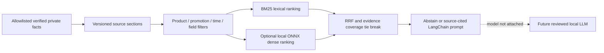

# Local knowledge retrieval and content tuning

Implemented release slice: a real LangChain retrieval/prompt pipeline, local multilingual ONNX embedding comparison, and a gated content LoRA preparation/train/evaluation entry point. No content model has been trained. No LLM is attached to the prompt pipeline. No API key, paid inference, TikTok write or automation change is involved.

## What runs now

Requires Node 22+. Dependencies are pinned in `package-lock.json`: `@langchain/core` 1.3.1 and `@huggingface/transformers` 4.3.2.

```powershell
npm ci
npm run knowledge -- index
npm run knowledge -- query "Dung tích Sakura?" sakura-cleaner-500ml evergreen-no-discount
npm run knowledge -- query "CTA gọi số điện thoại trong bio" sakura-cleaner-500ml evergreen-no-discount
npm run knowledge -- query "Ưu đãi Sakura TikTok hiện tại?" sakura-cleaner-500ml evergreen-no-discount
```

`index` reads an allowlist from the canonical private product, [current campaign goal](CAMPAIGN_GOAL.md), reviewed [footage policy](FOOTAGE_EDITING.md), and private call-only CTA policy. Five sections cover500ml identity, evergreen eligibility policy, material questions, current editorial/voice direction and the call-only CTA. The latest goal supplies the October31 cadence, rather than the earlier20/day paragraph. New unsubmitted media is evergreen/no-discount. The CTA is “Gọi số điện thoại trong bio để được tư vấn”; public internal codes, inbox requests, invented numbers and clickable-link claims are excluded.

The old first50-order card is **not current entitlement**. Unknown redemption counts and a historical visual-card approval cannot authorize a new discount. The active corpus contains no `offer` or `remainingOrders` claim field; current-offer, price and remaining-order questions abstain. Historical accepted offers remain unchanged in canonical state and are not imported as eligibility. Even a ledger-shaped object is not activated by this importer: future eligibility integration needs explicit source/time/policy validation. The importer does not serialize campaign messages, leads, credentials, media paths, historical captions, receipts, contact numbers or whole campaign/facts objects.

The bounded source sections carry `sourceId`, `sourceUri`, `sourceHash`, `productId`, `promotionKey`, `verifiedAt`, `validFrom`, `validTo`, `section` and `claimFields`. Identity retains the original label/card QA timestamp, **2026-10-28T02:36:21.386Z**, independently of the old promotion object or document edits. It does not assert a new label inspection. Policy document modification times are explicitly policy observations only; the CTA uses its declared user-policy update time. None verifies current discounts, redemption or cleaning efficacy. A changed label identity or pinned editorial facts section fails closed; missing/ambiguous current goal or changed CTA contract requires importer review. Execution-section edits cannot renew the label's evidence date.

Index and models live outside Git, by default at `%USERPROFILE%/.codex/data/tiktok-autoposting/knowledge/`. Corpus hashes and source IDs make indexing deterministic and idempotent; removed sections disappear on rebuild. `index.json` is replaced through a temporary file. One preparation owner should write a knowledge directory at a time. `TIKTOK_KNOWLEDGE_DIR` can override the private directory; do not point it into tracked source folders.



The default retriever is **lexical BM25**, not semantic embeddings. The optional hybrid backend uses actual pretrained multilingual sentence embeddings: q8 CPU ONNX inference, mean pooling, L2 normalization, ranked-list reciprocal rank fusion, and a deterministic evidence-coverage tie break. This is a small JSON/in-memory index, chosen for the bounded five-section corpus rather than a separately operated vector database. Models can be replaced through the isolated embedder interface; model revision, dtype, pooling, normalization, vector checksum and corpus hash are recorded. A changed corpus/model invalidates its embedding index.

Retrieval requires the exact product and promotion key. The knowledge CLI now defaults to `evergreen-no-discount`; examples also pass it explicitly. A `*` source is product-wide policy/identity, never an offer entitlement. Validity and a default seven-day evidence freshness window run before scoring. Future evidence dates are excluded. The original label therefore becomes stale after seven days unless actually reverified; rebuilding or touching policy files does not renew it. Unverified offer, price, remaining orders, deadline and certification questions abstain even when related text matches. Dense-only retrieval requires adequate similarity and a top-result margin; these preliminary safeguards do not guarantee factual coverage. Unrecognized unsupported claims still need editorial review.

`RunnableSequence` invokes retrieval and builds a `ChatPromptTemplate` using real LangChain `Document` objects. The supported local `invoke` wrapper isolates callbacks and refuses enabled LangSmith/LangChain cloud tracing before private data enters the chain. Results report `mode: retrieval-and-prompt-only`, source snippets/IDs/timestamps, index hash, retrieval backend and latency. Compound questions require evidence covering every recognized requested field; if topK cannot cover all fields the pipeline abstains. An abstention produces no prompt. There is no fabricated model answer, semantic score from hashes, generation quality score or inferred winning angle.

## Optional local semantic retrieval

Two pinned models are implemented:

| Key | Hub model | Revision | Query/passage treatment |
| --- | --- | --- | --- |
| `minilm` | Xenova/paraphrase-multilingual-MiniLM-L12-v2 | 2c4055b12046f11709e9df2c122e59ffbdc2f900 | Plain text |
| `e5` | Xenova/multilingual-e5-small | 761b726dd34fb83930e26aab4e9ac3899aa1fa78 | `query: ` / `passage: ` |

Download is explicit and only fetches public model files. Campaign text is embedded locally, never sent to a provider. Subsequent `hybrid-query` and comparison without the download flag disable remote model loading and use the local pinned snapshot directory. This explicit local path also avoids a Transformers.js v4 offline tokenizer-discovery issue observed during implementation.

```powershell
npm run knowledge -- compare-embeddings "C:\private\retrieval-cases.json" --download-models
npm run knowledge -- hybrid-query e5 "What is the bottle capacity?" sakura-cleaner-500ml evergreen-no-discount
npm run knowledge -- hybrid-query e5 "Chính sách video footage và giọng nữ miền Nam?" sakura-cleaner-500ml evergreen-no-discount
npm run knowledge -- compare-embeddings "C:\private\retrieval-cases.json"
```

An evaluation file is a JSON array of objects containing `query`, `productId`, `promotionKey`, ISO `asOf`, `topK`, `expectedSourceIds`, and `expectAbstention`. Labels express relevance of known factual sections; they are not content-success labels. `evaluate` benchmarks lexical retrieval; `compare-embeddings` benchmarks lexical plus both real hybrid models. Metrics include precision@k (denominator k), recall@k, MRR, NDCG, abstention accuracy and per-query latency. Ranking means use answerable cases only; negative cases count toward abstention accuracy.

Executed October28 on the actual campaign corpus (initially three source sections, then rerun after adding the fourth editorial section), with ten manually specified factual development cases (six answerable, four negatives), topK=1:

| Backend | Recall@1 / MRR / NDCG | Abstention accuracy |
| --- | --- | --- |
| BM25 | 0.667 | 0.80 |
| BM25 + multilingual MiniLM | 0.667 | 0.80 |
| BM25 + multilingual E5 | 1.000 | 1.00 |

The E5 result includes cross-language retrieval of bottle capacity and material questions. The initial E5 run retrieved an unrelated weather question; the explicit ambiguity-margin rule now rejects that case. These cases informed development and are **not an independent acceptance set**. Do not generalize the perfect development result to production. Private artifacts: `retrieval-cases.json`, `embedding-comparison.json`, `embeddings-minilm.json`, `embeddings-e5.json` and downloaded model snapshots under the knowledge directory. Re-running confirmed both embedding indexes were unchanged and offline model reload worked. Startup and inference use CPU; no Intel Arc or CUDA acceleration is claimed.

Those October28 results describe the historical corpus, not acceptance of the current evergreen corpus. The October31 importer regression checks cover missing/stale/unknown offers, private-field exclusion, immutable label timestamps, identity/CTA/editorial retrieval and idempotent indexing. The local rebuild replaces the historical active offer source; existing pinned E5 assets can rebuild the five source vectors offline without downloads. Preserve the prior index/embedding JSON privately for audit; a successful rebuild is not a new policy or label verification.

Executed October31: the five-section corpus is `3223e1a90981782e9d63253dde4bd7ed3761aa68bc4fe99c3b1640f720718d53`. Existing cached E5 weights rebuilt its vectors with remote loading disabled. Seven source-cited LangChain development smoke cases passed: four top1 matches (identity, call CTA, current editorial and evergreen policy), plus three abstentions (offer, remaining orders and price). This is not an independent acceptance benchmark. The private `evergreen-audit-3223e1a90981782e.json` records queries, source snippets, prompts and metrics; `audit-before-evergreen-e23d1c342b31f963/` retains the previous index/E5 JSON. Sixteen targeted knowledge tests passed with no skips, including the CLI's evergreen default and Python's non-training bundle checks. No canonical campaign, queue, receipt, policy document or model weights were changed by this rebuild.

Before production expansion: collect independently reviewed Vietnamese paraphrases and unknown-fact negatives, evaluate on the larger actual corpus, calibrate rejection on a separate development set, then freeze thresholds and run held-out acceptance. Target recall@3 >=0.8, MRR >=0.8 and abstention accuracy >=0.95 on that independent set. Evaluate a cross-encoder reranker if corpus ambiguity warrants it. No production-sized corpus, independent semantic benchmark or generation acceptance has passed yet.

## Integration coverage and limits

RAG has been exercised through the local LangChain query/brief preparation paths. The scale-video preview producer now calls the production-grounding helper after brief validation and before model/media runtimes, and binds the result into its private receipt/cache. Its `--grounding-only` path prepares a private evidence audit without rendering. This is **not automatically applied to every narration, wording correction or research action**. Vietnamese natural-copy review and external research evidence remain separate processes; they are not fine-tuning. The current index does not ingest all research ledgers or performance observations.

Historical footage-test/carousel producers still require the old offer source and first50 promotion key. New runs of those historical paths must remain blocked by evergreen offer abstention; do not restore that source just to satisfy their assumptions. Their templates/renderer need a separately reviewed evergreen migration. Existing accepted assets and exact approved narration stay unchanged. A prompt or corpus hash stored earlier does not prove that a later correction was retrieved against current evidence; per-operation grounding/hash records are still needed for universal enforcement. CTA is presently retrieved lexically/as a general source rather than a dedicated recognized query field, so compound requests need explicit source-coverage review.

Neither content nor voice has a trained adapter. The VieNeu narration engine is a pretrained local voice system with selected conditioning and exact listening approvals, not a newly fine-tuned Sakura voice. No generative content LLM is attached. Retrieval returns source-cited prompts, not model-written answers or factual certification.

## Reusable production grounding

[production-grounding.mjs](../src/knowledge/production-grounding.mjs) provides read-only `createProductionGrounding` and `checkProductionGrounding`. No model, media, queue or browser is loaded or written. Exact-ID coverage uses local BM25 through the genuine LangChain pipeline; it does not need to load E5 or any other embedding model. Five independent retrievals require identity/volume, material questions, call-only CTA, evergreen eligibility policy and editorial/voice policy. A related source cannot substitute for a missing exact ID. Producers may pass `requiredSourceIds: evergreenRequiredSourceIds` explicitly; they cannot drop a required section to obtain a pass.

```javascript
import {
  createProductionGrounding, checkProductionGrounding,
  evergreenRequiredSourceIds,
} from './src/knowledge/production-grounding.mjs';

// Use the exact final strings, including overlays/caption and spoken script.
const input = {
  account: 'saigomlia', productId: 'sakura-cleaner-500ml',
  publicCopy: {script, headline, caption, cta},
  requiredSourceIds: evergreenRequiredSourceIds,
};
const record = await createProductionGrounding(input);
if (!record.evidenceCoveragePassed) throw Error(record.blockers.join(', '));
const checked = await checkProductionGrounding(record, input);
if (!checked.valid) throw Error(checked.blockers.join(', '));
// Save the audit only to a private producer artifact; continue other QA gates.
```

The helper loads the current private index unless the caller explicitly supplies an `index`/`directory` (for example isolated fixtures). Both operations verify index consistency and apply current product/promotion/source-time filters. Missing, stale, future, expired, wrong-product or missing-field evidence abstains. The source age ceiling is168hours and can only be tightened. Historical promotion keys and detected discount/offer copy are rejected by this evergreen-only contract, even if a historical offer section exists. This bounded gate does not interpret every free-form sentence or certify the copy's claims.

Records contain the corpus hash; exact source IDs, hashes, record hashes, snippets and date bases; separate public-copy/script hashes; account/product; `asOf` and `reviewedAt`. `reviewedAt` is an **automated evidence-check timestamp**, not human review. `contentHash` covers exact strings plus account/product/promotion. `bindingHash` additionally covers the corpus/source records and freshness contract but excludes check/review timestamps, so a fresh identical check does not invalidate a media cache. The complete `recordHash` includes audit timestamps. Object field order is canonicalized; actual text, line breaks and array order remain exact. These checksums detect inconsistent artifacts, not an authorized actor rewriting all hashes.

`createProductionGrounding` returns `status:'grounded'|'abstained'` and `evidenceCoveragePassed`. `checkProductionGrounding` returns `{valid, blockers, currentRecord}` after rechecking exact copy against the **current** index. Expected coverage/binding failures return false; callers **must inspect the result**, rather than rely on an exception. Invalid arguments or a corrupt index may throw. A changed script/caption/account/product/corpus/source or newly stale evidence fails checking. Both results retain `scope:'required-source-evidence-coverage-only'`, `ready:false`, `humanReviewed:false`, `generativeLLMUsed:false` and `fineTunedModelUsed:false` where applicable. A pass is not factual/copy/listening approval or posting readiness; exact audio approval, rendered QA, native music and actual submission checks remain separate.

Index consistency alone cannot detect an edited source policy that has not been reindexed. The scale renderer's default production path compares the loaded corpus with the current allowlisted `campaignSources` build and blocks discrepancies pending safe reindexing. Explicit fixture indexes bypass that live-source comparison. Other producers must implement the same freshness boundary before treating a loaded index as current. The helper itself never renews label evidence dates or silently rebuilds policy/index data.

`node --test test/knowledge-production-grounding.test.mjs` covers all five exact IDs, immutable copy/script binding, timestamp-independent cache keys, source freshness/expiry/product filters, historical/unknown offers, missing claim fields, tampering, corrupt/current corpus changes and absence of false readiness. These are synthetic technical fixtures, not product evidence or training examples.

## Content fine-tuning readiness

Existing drafts, generated examples, published posts, views and unreviewed captions do not become positive training labels automatically. There are currently no imported human-approved real content-training records. Preparation of an empty file writes a blocked manifest; training refuses it. Content editorial approval and attributed commercial performance are distinct evidence.

Provide an explicit private JSONL file, one record per human-reviewed example:

```json
{"id":"real-example-id","groupId":"story-family-id","sourcePostId":"real-source-post-id","productId":"sakura-cleaner-500ml","promotionKey":"evergreen-no-discount","instruction":"Real editorial task using supplied identity facts","response":"Actual human-approved response","sourceIds":["sakura:identity:500ml"],"consentForTraining":true,"labelKind":"editorial_approved","review":{"approved":true,"reviewer":"editor-id","reviewedAt":"2026-10-31T01:00:00Z"}}
```

This schema is illustrative, not an approved training example. Preparation rejects missing fields, unreviewed/unsupported labels, absent training consent, apparent private contact information, future reviews, stale/expired/cross-product/cross-promotion sources and out-of-bounds text. Source evidence is inserted into the user message so the content model learns to respond to supplied facts. It is not meant to memorize changing offers.

Normalized duplicate responses and near duplicates (five-gram Jaccard >=0.8) are removed. Connections from removed duplicates are preserved, so a duplicate bridging story families/source posts cannot leak related surviving examples across deterministic train/validation/heldout splits. Approximately70/10/20% of independent groups are used; uneven group sizes may change example proportions. The heldout set is never used for early stopping. The manifest includes split counts, duplicate IDs, dataset/source hashes and a lexical-token histogram; actual model-token bounds are checked before training without silent truncation.

Readiness requires >=50 unique examples, >=10 independent groups, >=40 train, >=5 validation and >=5 heldout records after deduplication. In practice more than50 inputs may be needed. The validator checks structure and consent declarations; an editor must still verify claims, rights, factual provenance and quality. It does not assert that supplied declarations are true or train a conversion predictor.

```powershell
npm run prepare:content-tuning -- "C:\private\reviewed-content.jsonl"
# Creates a versioned private content-tuning/<dataset-hash>/ bundle; exit2 if not ready.

python scripts/train-content.py check --dataset "C:\private\content-tuning\dataset-hash"
```

`check` validates the bundle hash, consent/approval and split leakage before importing ML libraries. It reports missing training packages without installing them. Create a **separate** content-training environment with PyTorch, Transformers, PEFT and Accelerate if ready; do not modify the voice runtime. The training path has been syntax checked and its non-training preflight exercised; no ML training/evaluation run is claimed.

The bounded CPU target is a local snapshot of Qwen2.5-0.5B-Instruct (Apache2.0). The published model includes Vietnamese among its supported languages; its small size does not establish natural Vietnamese marketing quality. No base weights are downloaded by `train-content.py`; it requires a local absolute snapshot and sets offline mode. No paid provider or bitsandbytes/CUDA assumption is made on the Intel Ultra5/15.5GB machine. CPU training may be slow.

LoRA configuration is explicit in the entry point: q_proj/v_proj, r8, alpha16, dropout0.1, learning rate1e-4, three-epoch ceiling, batch1, accumulation8, cosine schedule, 10% warmup, weight decay0.01, float32 CPU,768-token limit and early stopping on validation loss. Conservative rank and regularization bound memory/overfitting risk; these values are starting hypotheses, not optimized hyperparameters.

```powershell
python scripts/train-content.py train --dataset "C:\private\bundle" --base-model "C:\private\Qwen2.5-0.5B-Instruct" --output "C:\private\new-content-run" --execute
python scripts/train-content.py evaluate --dataset "C:\private\bundle" --base-model "C:\private\Qwen2.5-0.5B-Instruct" --adapter "C:\private\new-content-run\adapter" --output "C:\private\new-content-evaluation" --execute
```

Training saves a real adapter only after trainer execution, records before/after validation loss and keeps `deployReady:false`. Evaluation requires matching dataset and base snapshot hashes, covering model weights, configuration, tokenizer and chat-template files. It loads the actual adapter, compares base/adapter heldout assistant-token loss/perplexity, ROUGE-L, generated examples and CPU latency, and flags the specific50-customers wording error. These automated metrics do not verify factual truth, conversational Vietnamese, conversion or broad promotion correctness. A content editor must review the complete heldout outputs and real campaign outcomes before deployment. No adapter merge, publication or service activation happens here. The voice adapter uses a separate dataset/model pipeline documented by the voice workstream.

## Primary sources checked October28,2026

- [LangChain retrieval concepts](https://docs.langchain.com/oss/javascript/deepagents/retrieval) and [RunnableSequence reference](https://reference.langchain.com/javascript/langchain-core/runnables/RunnableSequence)
- [Transformers.js feature-extraction API](https://huggingface.co/docs/transformers.js/v3.0.0/en/api/pipelines), [current pipeline guide](https://huggingface.co/docs/transformers.js/pipelines), [MiniLM ONNX card](https://huggingface.co/Xenova/paraphrase-multilingual-MiniLM-L12-v2), [E5 ONNX card](https://huggingface.co/Xenova/multilingual-e5-small), [E5 upstream](https://github.com/microsoft/unilm/tree/master/e5)
- [PEFT quicktour](https://huggingface.co/docs/peft/main/quicktour), [LoRA configuration](https://huggingface.co/docs/peft/main/package_reference/lora), [Transformers Trainer](https://huggingface.co/docs/transformers/en/main_classes/trainer), [Qwen2.5-0.5B-Instruct model card](https://huggingface.co/Qwen/Qwen2.5-0.5B-Instruct)

Upstream APIs are verified against the installed LangChain/Transformers.js packages in executed local tests. Training extras and base/adapter behavior still require a separate ready dataset and an actual training run.
